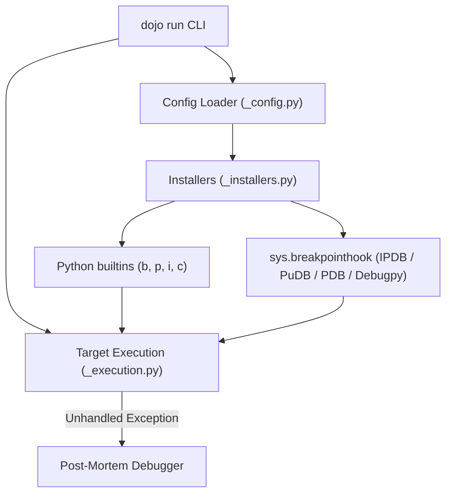
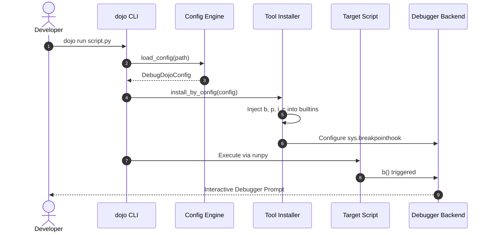
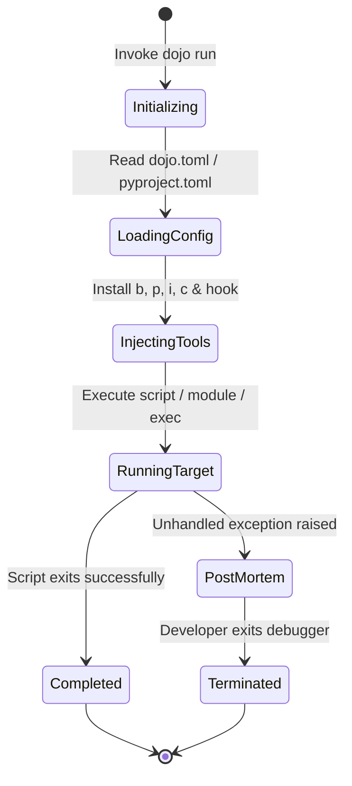

# Getting Started

This tutorial guides you through installing **Debug Dojo**, running a Python script
with debugging tools pre-injected, and using global inspection helpers.

## Prerequisites

Ensure you have Python 3.10+ and [`uv`](https://docs.astral.sh/uv/) installed.

## 1. Installation

Install `debug-dojo` in your project virtual environment using `uv`:

```console
uv add "debug-dojo[all-debuggers]"
```

The `all-debuggers` extra installs `ipdb`, `pudb`, and `debugpy`. If you only need the
standard library `pdb`, install without extras:

```console
uv add debug-dojo
```

## 2. Zero-Import CLI Debugging

With `debug-dojo`, you can execute any Python script while automatically injecting
inspection shortcuts into Python's `builtins`.

Create a sample script named `debug_demo.py`:

```python
"""Sample script demonstrating Debug Dojo builtins."""

config_payload = {
    "server": "us-east-1",
    "retries": 3,
    "features": ["auth", "caching", "metrics"],
}

# Injected helpers are available without importing!
p(config_payload)
i(config_payload)
b()
```

Run the script using `dojo run`:

<div class="termy">

```console
$ dojo run debug_demo.py

// Output formatted by Rich pretty-print
{'server': 'us-east-1', 'retries': 3, 'features': ['auth', 'caching', 'metrics']}

// Output formatted by Rich inspect
╭─────────────────────────────── <class 'dict'> ───────────────────────────────╮
│ dict() -> new empty dictionary                                               │
│                                                                              │
│ ╭──────────────────────────────────────────────────────────────────────────╮ │
│ │ {'server': 'us-east-1', 'retries': 3, 'features': ['auth', 'caching'... │ │
│ ╰──────────────────────────────────────────────────────────────────────────╯ │
│                                                                              │
│      clear = def clear(...) D.clear() -> None.  Remove all items from D.     │
│       copy = def copy(...) D.copy() -> a shallow copy of D                   │
│      items = def items(...) D.items() -> a set-like object providing a view  │
│       keys = def keys(...) D.keys() -> a set-like object providing a view    │
╰──────────────────────────────────────────────────────────────────────────────╯

// Injected b() stops execution in your configured debugger
ipdb> p config_payload['server']
'us-east-1'
ipdb> c
```

</div>

## 3. Comparing Objects Side-by-Side

Use the `c(obj1, obj2)` helper to compare two dictionaries, objects, or data models.
Differences are displayed in a formatted side-by-side terminal table.

<div class="termy">

```console
$ python -c "import debug_dojo.install; c({'a': 1, 'b': 2}, {'a': 1, 'b': 3})"

┌───────────────────────────────────────┬──────────────────────────────────────┐
│ ╭───────────────────────────────────╮ │ ╭──────────────────────────────────╮ │
│ │ <class 'dict'>                    │ │ │ <class 'dict'>                   │ │
│ │                                   │ │ │                                  │ │
│ │ Value:                            │ │ │ Value:                           │ │
│ │   {'a': 1, 'b': 2}                │ │ │   {'a': 1, 'b': 3}               │ │
│ │                                   │ │ │                                  │ │
│ │ No attributes or methods to       │ │ │ No attributes or methods to      │ │
│ │ display for this type.            │ │ │ display for this type.           │ │
│ ╰───────────────────────────────────╯ │ ╰──────────────────────────────────╯ │
└───────────────────────────────────────┴──────────────────────────────────────┘
```

</div>

## 4. In-Code Activation

When running tests or scripts where you cannot use the `dojo run` CLI wrapper, import
`debug_dojo.install` once in your module or test fixture:

```python
import debug_dojo.install

# The following helpers are now globally accessible:
# - b(): Set a breakpoint using the configured debugger
# - p(obj): Rich pretty-print
# - i(obj): Rich object inspection
# - c(obj1, obj2): Side-by-side comparison table
```

## 5. Automatic Post-Mortem Debugging

When `dojo run` encounters an unhandled exception, it formats the traceback with Rich
syntax highlighting and enters a post-mortem debugging session at the exact frame
where the failure occurred:

<div class="termy">

```console
$ dojo run failing_script.py

<b>Error while running failing_script.py:</b>
ZeroDivisionError: division by zero

Traceback (most recent call last):
  File "/workspace/failing_script.py", line 4, in <module>
    compute(0)
  File "/workspace/failing_script.py", line 2, in compute
    return 100 / divisor
           ^^^^^^^^^^^^^
ZeroDivisionError: division by zero

<b>Entering post-mortem debugging session...</b>
> /workspace/failing_script.py(2)compute()
-> return 100 / divisor
ipdb> p divisor
0
ipdb> q
```

</div>

## Architecture & Lifecycles

The diagrams below describe how `debug-dojo` sets up the debugging environment,
executes targets, and manages failure states.

### Component Architecture



### Execution Lifecycle



### State Lifecycle



## Development Workflow

To contribute to Debug Dojo, clone the repository and synchronize the environment:

```console
git clone https://github.com/bwrob/debug-dojo.git
cd debug-dojo
uv sync
```

Run tests and verification tasks using Poe the Poet:

```console
# Run unit tests with coverage
uv run poe test

# Run all code quality checks
uv run poe code-quality

# Preview documentation locally
uv run poe docs-serve
```

> [!TIP]
> When browsing docs, press ++slash++ or ++cmd+k++ (or ++ctrl+k++ on Linux/Windows) to
> search documentation symbols and pages. Hovering internal links activates floating
> previews.
