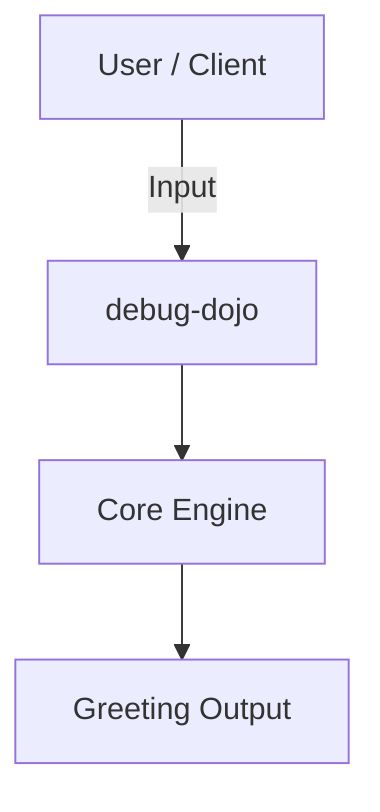
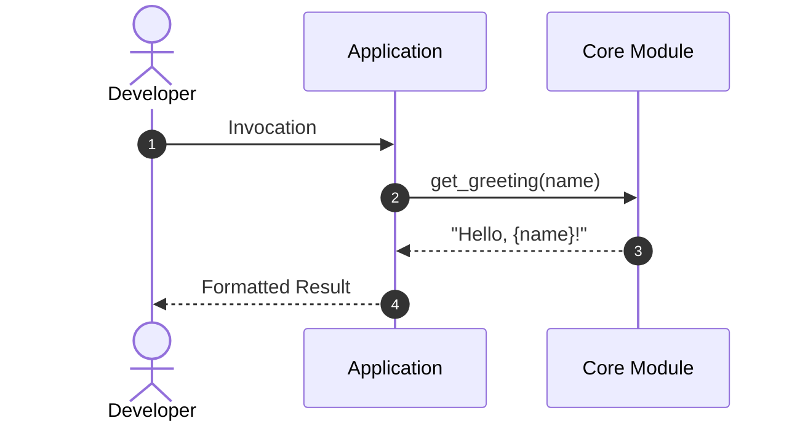
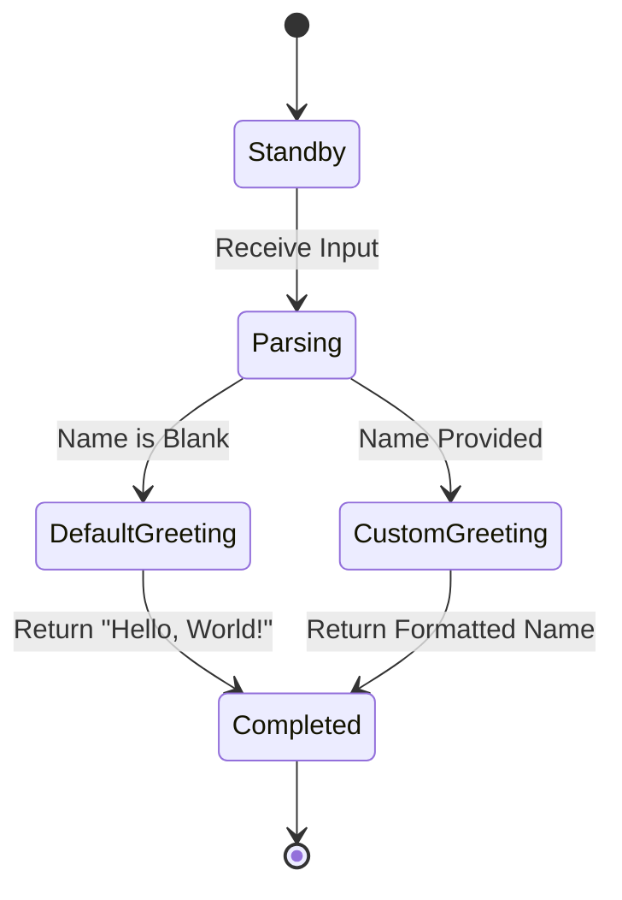

# Getting Started

This guide explains how to install and develop with **Debug Dojo**.

## Prerequisites

Ensure you have Python 3.12 and `uv` installed.

## Installation

Install using `uv`:

```bash
uv add debug-dojo
```

## Basic Usage

Import the primary functions into your application:

```python
from your_package import get_greeting

message = get_greeting("Developer")
print(message)
```

Replace `your_package` with the generated package name.

## CLI Usage

Run commands directly via `uv`:

<div class="termy">

```console
$ uv run debug-dojo greet "World"

✨ Hello, World!

// Inspect CLI options and help
$ uv run debug-dojo --help

<b>Usage: </b><b>debug-dojo [OPTIONS] COMMAND [ARGS]...</b>

╭─ Options ─────────────────────────────────────────╮
│ --version  -v        Show version and exit.       │
│ --help               Show this message and exit.  │
╰───────────────────────────────────────────────────╯
╭─ Commands ────────────────────────────────────────╮
│ greet                Display a personalized       │
│                      greeting.                    │
╰───────────────────────────────────────────────────╯
```

</div>

## Development Workflow

Clone the project and synchronize development dependencies:

```bash
git clone \
  https://github.com/bwrob/debug-dojo.git
cd debug-dojo
uv sync
```

Run test suites and quality checks with Poe the Poet:

```bash
# Run tests
uv run poe test

# Run quality checks
uv run poe code-quality
```

???+ tip "Hermetic Task Execution"

```text
Always invoke tasks using `uv run poe <task>`. Tasks inherit project
environment flags, strict encoding checks (`PYTHONUTF8=1`), and hermetic
virtual environments.
```

??? example "Advanced Testing & Marker Options"

    Free arguments can be forwarded directly through Poe to underlying
    tools using `--`:

    ```bash
    uv run poe test -- -k "test_greeting" -v
    ```

### Verification Checklist

- [x] Python 3.12 and `uv` installed
- [x] Project cloned and dependencies locked
- [ ] Run test suite with `uv run poe test`
- [ ] Run code quality checks with `uv run poe code-quality`
- [ ] Preview documentation with `uv run poe docs-serve`

> [!NOTE]
> To enable automated documentation deployment to GitHub Pages via
> `.github/workflows/docs.yaml`, open your GitHub repository, navigate to **Settings** →
> **Pages**, and set **Build and deployment** → **Source** to **GitHub Actions**.

> [!TIP]
> When browsing docs, press ++slash++ or ++cmd+k++ (or ++ctrl+k++ on Linux/Windows) to
> instantly search documentation symbols and pages. Hovering internal links like
> [API Reference](api-reference.md) activates floating link previews.

### Tested Code Snippets

Code snippets can be embedded directly from verified tests or source files using
`--8<--`:

```markdown
--8<-- "tests/test_config.py:10:15"
```

## Architecture & Diagrams

Mermaid diagrams render natively in documentation. Below are examples illustrating
the project structure, execution sequence, and state lifecycle:

### Component Architecture



### Execution Lifecycle



### State Lifecycle


